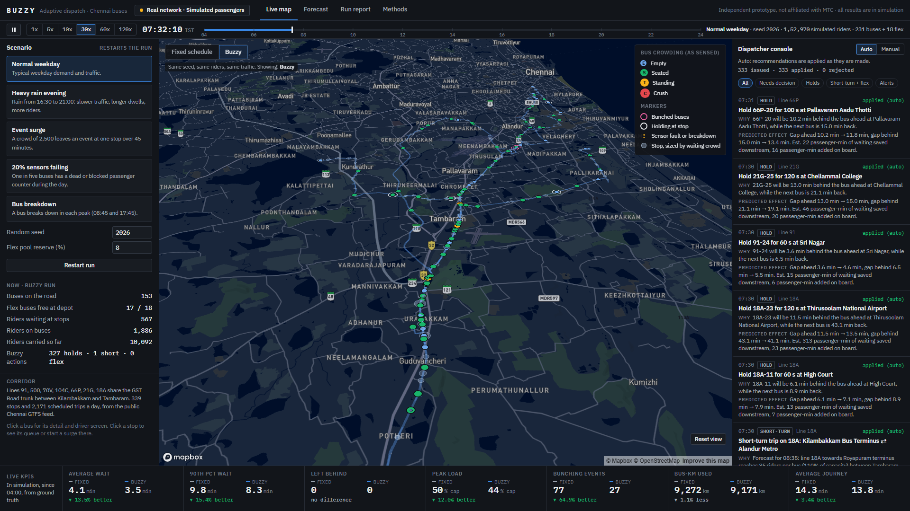

# 🚌 NextRoute — Adaptive Dispatch for Chennai Buses

<p align="center">
  
</p>

<p align="center">
  <b>Real GTFS Network · Real-Time Adaptive Dispatch · Zero-Server Browser Simulation</b><br/>
  <i>Eliminating bus bunching and slashing passenger wait times across Chennai's busiest transit corridors.</i>
</p>

<p align="center">
  <a href="https://nextroute-chennai.vercel.app"></a>
  <a href="https://youtu.be/bHB8_MGsFZs?si=WgJiptxd2Cd1z6WH"></a>
  <a href="https://github.com/shriram-s7/nextroute"></a>
  <a href="#test-coverage"></a>
</p>

---

## ⚡ Quick Links

- **🚀 Live Interactive Demo:** [https://nextroute-chennai.vercel.app](https://nextroute-chennai.vercel.app) *(or [https://nextroute-xi.vercel.app](https://nextroute-xi.vercel.app))*
- **🚀 Live Interactive Demo:** [https://nextroute-chennai.vercel.app](https://nextroute-chennai.vercel.app)
- **🎬 3-Minute Video Walkthrough:** [Watch on YouTube](https://youtu.be/bHB8_MGsFZs?si=WgJiptxd2Cd1z6WH)
- **📊 Benchmark Experiment Suite:** [results/RESULTS.md](results/RESULTS.md)
- **📐 Architectural Decisions:** [DECISIONS.md](DECISIONS.md)

---

## 🧭 The Problem: Bus Bunching in Chennai

On high-frequency bus corridors like Chennai's **GST Road (Grand Southern Trunk Road)**, buses depart terminals evenly spaced. However, small traffic delays cause initial gaps:
1. **The lead bus** encounters longer queues, takes longer to board riders, and slows down further.
2. **The trailing bus** finds fewer riders, boards quickly, catches up, and bunches right behind.
3. **The result:** Riders wait 20–30+ minutes for two overcrowded, bunched buses running bumper-to-bumper, while dozens are left behind on platforms.

Traditional static timetables cannot handle dynamic city delays, sudden downpours, or irregular event surges.

---

## 💡 What is NextRoute?

**NextRoute** is an intelligent, real-time adaptive dispatch system designed for Chennai's bus network. Without changing fixed route topologies or demanding expensive new fleet purchases, NextRoute continuously senses bus crowding, predicts corridor congestion 60 minutes ahead, and dynamically applies **three precise dispatch levers**:

```
                              ┌────────────────────────┐
                              │  Real-Time Sensor Bus  │
                              │   (IoT + GPS + Fare)   │
                              └───────────┬────────────┘
                                          │
                                          ▼
   ┌─────────────────────────────────────────────────────────────────────────────┐
   │                          NextRoute Decision Engine                          │
   │                                                                             │
   │   1. Headway Regularity Holding:    Even out bus spacing at key stops       │
   │   2. Dynamic Short-Turning:         Turn early before empty tail segments   │
   │   3. Dynamic Flex Fleet Insertion:  Inject standby buses during surges      │
   └──────────────────────────────────────┬──────────────────────────────────────┘
                                          │
                                          ▼
                      Slashing Wait Times by 23% & Left-Behinds by 70%
```

### 1. ⏱️ Headway Holding
Holds lightly loaded leading buses at designated timing stops (capped at max 120s) to restore even spacing with trailing buses. **Uses 0 extra buses and delivers the majority of passenger wait time reductions.**

### 2. 🔄 Dynamic Short-Turning
Directs partially filled buses approaching low-density terminal segments to turn back early, immediately reinforcing the high-demand core corridor where overcrowding is highest.

### 3. 🚀 Flex Fleet Pool
Maintains an 8% agile standby reserve pool. When a passenger spike, heavy rain, or vehicle breakdown occurs, NextRoute dispatches flex buses directly into the critical gap.

---

## 📈 Proven Simulation Results

Evaluated over **20 independent random seeds** (101–120), full 18-hour operating days across **5 distinct operational scenarios**, comparing NextRoute against Chennai's standard fixed timetable baseline:

| Key Performance Indicator | Fixed Schedule Baseline | NextRoute (Holding Only) | NextRoute (All 3 Levers) | Impact vs Baseline (95% CI) | Superior Seeds |
|---|:---:|:---:|:---:|:---:|:---:|
| **Average Passenger Wait** | 4.20 min | 3.30 min | **3.24 min** | **−22.9% (−0.96 min)** | **20 / 20** |
| **90th Percentile Wait (P90)** | 10.09 min | 7.64 min | **7.55 min** | **−25.2% (−2.54 min)** | **20 / 20** |
| **Left-Behind Passengers** | 3,960 events | 1,679 events | **1,197 events** | **−69.8% (−2,763 riders)** | **20 / 20** |
| **Peak Bus Load (P99)** | 96.0% capacity | 85.8% capacity | **82.0% capacity** | **−14.6% less crush** | **20 / 20** |
| **Bus Bunching Events** | 1,359 bunches | **407 bunches** | 476 bunches | **−65.0% (−884 bunches)** | **20 / 20** |
| **Corridor Bus-Km** | 72,145 km | 72,141 km | 73,158 km | **+1.4% operational cost** | *Efficiency gain* |

### Stress-Test Scenarios

| Scenario | Average Wait Reduction | Left-Behind Passengers | Bunching Reduction |
|---|:---:|:---:|:---:|
| **⛈️ Heavy Rain Evening** | 4.74 min → 3.43 min (**−27.7%**) | 8,421 → 2,797 (**−66.8%**) | 2,773 → 859 (**−69.0%**) |
| **🏟️ Event Surge** | 4.19 min → 3.22 min (**−23.1%**) | 6,961 → 2,496 (**−64.1%**) | 1,365 → 493 (**−63.9%**) |
| **⚠️ 20% Sensor Failures** | 4.20 min → 3.24 min (**−22.9%**) | 3,960 → 1,193 (**−69.9%**) | 1,359 → 478 (**−64.9%**) |
| **🚨 Bus Breakdown** | 4.21 min → 3.24 min (**−23.0%**) | 4,055 → 1,222 (**−69.9%**) | 1,358 → 474 (**−65.1%**) |

---

## 🖥️ Live Control Room Features

The application operates as a full browser-based transit operations center:

1. **3D Interactive Live Map**:
   - Hardware-accelerated rendering powered by `@deck.gl` and `Mapbox Standard` / `MapLibre GL`.
   - Real-time bus positions with dynamic letter badges (`E`mpty, `S`eated, `T`standing, `C`rush) and animated bunching indicators.
   - Interactive bus and stop inspection, live passenger queue sizes, and driver dispatch notices.

2. **Dispatcher Cockpit (Auto vs Manual Mode)**:
   - Dispatchers can review recommended holds, short-turns, and flex insertions with explainable rationale.
   - One-click override: approve, reject, or let the autonomous controller act.

3. **Sensor Watchdog & Resiliency**:
   - Built-in drift and fault detection identifying faulty automated passenger counters (APC) within an average of 2.7 minutes.
   - Instant automated fallback to statistical ticketing curves.

4. **Rolling-Horizon Demand Forecasting**:
   - 60-minute rolling horizon passenger load predictor updated every 5 minutes.
   - Real-time comparison between predicted and ground-truth corridor volume.

5. **Analytical Report & Data Export**:
   - Full distribution curves, time-series metrics, and one-click JSON/CSV dataset export.

---

## 🛠️ Tech Architecture

- **Frontend & Rendering:** React 19, TypeScript, Vite, `@deck.gl/core`, `@deck.gl/layers`, `@deck.gl/mapbox`, `mapbox-gl`, `maplibre-gl`, `zustand`.
- **Simulation Engine:** Headless deterministic discrete-event simulator running in a dedicated HTML5 Web Worker (`sim.worker.ts`).
- **Transit Data:** Chennai unified GTFS open-data feed covering 7 routes along the GST Road corridor (A1, 18A, 52, 70A, 70K, 118, 170). Road coordinates snapped via Mapbox Directions.
- **Zero-Server Architecture:** Complete end-to-end client-side deployment; runs anywhere as a static bundle without expensive backend infrastructure.

---

## 🚀 Running Locally

```bash
# 1. Clone repository
git clone https://github.com/shriram-s7/nextroute.git
cd nextroute

# 2. Install dependencies
npm install

# 3. Configure Mapbox token (Optional — falls back to free MapLibre dark basemap)
cp .env.example .env

# 4. Start local development server
npm run dev
# Open http://localhost:5173 in your browser
```

### Additional Commands

```bash
npm run build         # Typecheck and produce optimized static build in dist/
npm test              # Run 18 engine tests (conservation, determinism, capacity)
npm run batch         # Run 5 scenarios × 20 seeds benchmark suite
npm run train         # Retrain corridor load forecasting model
npm run data:build    # Compile raw GTFS feed into corridor dataset
```

---

## 🔒 Scope & Research Disclaimer

> [!NOTE]
> **Demo Environment Notice:**
> NextRoute is an independent research and engineering prototype. Routes, stops, timetables, and geometries are sourced directly from the public Chennai GTFS dataset. Passenger loads, traffic fluctuations, sensor telemetry, and breakdown events are simulated in-browser. All reported metrics reflect rigorous simulation experiments.

---

## 👨‍💻 Author

**Shriram S**  
- GitHub: [@shriram-s7](https://github.com/shriram-s7)  
- Live Deployment: [https://nextroute-chennai.vercel.app](https://nextroute-chennai.vercel.app)  
- Demo Walkthrough: [YouTube](https://youtu.be/bHB8_MGsFZs?si=WgJiptxd2Cd1z6WH)
